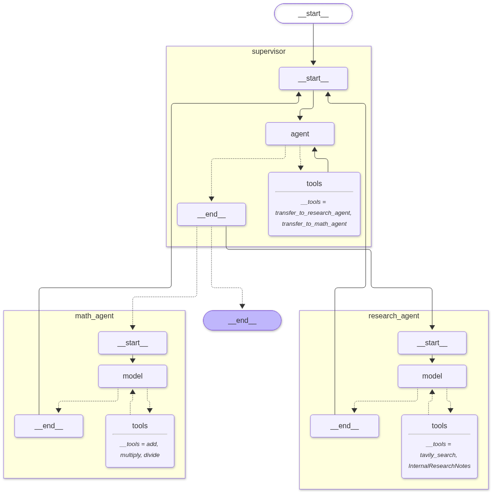

# supervisor_multi_agent_rag

A simple multi-agent system where a **supervisor** routes tasks to specialized agents. Built with LangChain and LangGraph.

## How it works

The supervisor reads the user's request and hands it to one agent at a time:

- **Research agent** – answers research questions using
  - `tavily_search` for live web search
  - `InternalResearchNotes`, a RAG tool (FAISS + HuggingFace embeddings) over `internal_docs.txt`
- **Math agent** – handles calculations with `add`, `multiply` and `divide` tools

Once an agent finishes, control goes back to the supervisor, which returns the final answer.



## Tech stack

- LangChain / LangGraph (`langgraph-supervisor`)
- Groq LLM: `openai/gpt-oss-120b`
- Tavily for web search
- FAISS + `sentence-transformers/all-MiniLM-L6-v2` for retrieval

## Setup

1. Clone the repo and install dependencies with [uv](https://docs.astral.sh/uv/):

   ```bash
   uv sync
   ```

   If you are starting from scratch, create the project and add the packages instead:

   ```bash
   uv init
   uv add langchain langgraph langchain-core langchain-community langchain-groq \
       langchain-tavily langchain-huggingface \
       langgraph-supervisor faiss-cpu sentence-transformers python-dotenv
   ```

2. Create a `.env` file in the project folder:

   ```
   GROQ_API_KEY=your_groq_key
   TAVILY_API_KEY=your_tavily_key
   ```

3. Add your own notes to `internal_docs.txt` (used by the internal RAG tool).

## Run

```bash
uv run main.py
```

The script saves the agent graph to `graph.png` and prints the final answer. To try a different question, edit the message in the `HumanMessage(...)` at the bottom of the file.

## Project structure

```
supervisor_multi_agent_rag/
├── main.py             # supervisor, agents and tools
├── internal_docs.txt   # knowledge base for the RAG tool
├── graph.png           # graph visualization
├── pyproject.toml      # dependencies (managed by uv)
├── .env                # API keys (do not commit)
└── README.md
```

## Notes

- The Groq calls are rate limited (about 1 request per 5 seconds) to stay within free-tier limits.
- `recursion_limit` is set to 12 to stop the agents from looping.